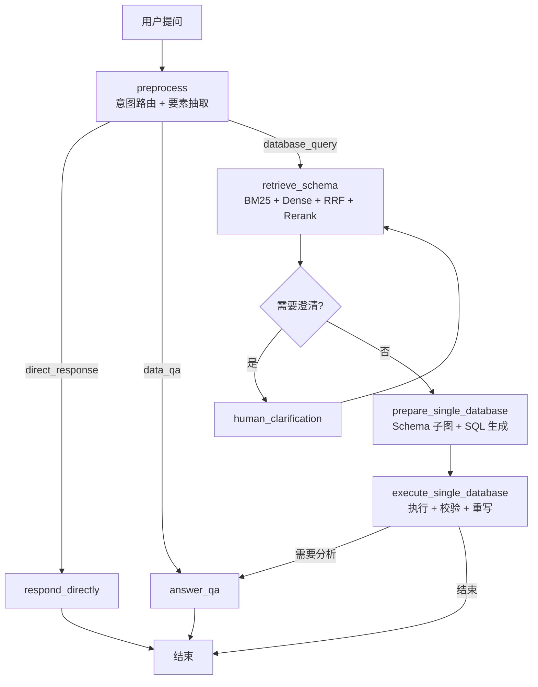

# AskSQL

> 自然语言问数系统：把「帮我查一下本月各地区销售额」变成一条可执行、可校验、可追溯的 SQL。

基于 **FastAPI + LangGraph** 的 Text-to-SQL Agent，开箱即可运行。

[](https://github.com/sha11owww/AskSQL/actions/workflows/ci.yml)
[](https://www.python.org/)
[](LICENSE)

---

## 它解决什么问题

Text-to-SQL 的难点从来不是「能不能生成一条 SQL」，而是三件事：

| 问题 | 本项目的做法 |
|---|---|
| 表太多，模型不知道看哪些字段 | 字段级混合检索（BM25 + Dense + RRF + Rerank），只把候选字段送进上下文 |
| 字段对了，但表之间怎么关联不知道 | 用预定义的关联做 BFS 最短路，把孤立字段连成连通子图 |
| SQL 跑通了，但算的不是用户要的 | 三层校验：意图规则比对 → 模型自评 → 带反馈重写 |

---

## 核心特性

- **字段级混合检索**：BM25（中文 bigram）+ 向量检索并行召回，RRF 融合后用 Rerank 精排，按阈值截断并限制最大字段数。
- **Schema 子图构建**：以命中字段所在表为起点做 BFS，沿表间关联补齐桥接字段，输出可直接注入提示词的结构化上下文。
- **LangGraph 状态图编排**：8 个节点覆盖意图路由、检索、生成执行、结果校验、串联分析，支持澄清中断与恢复。
- **受限 ReAct 查询**：模型通过 MCP 工具调用取数，工具调用次数、重试次数、校验重写次数均有硬上限。
- **SQL 安全护栏**：`sqlglot` AST 校验，只允许单条 `SELECT` / `WITH`，拒绝写操作与 `SELECT *`；权限在检索阶段就已过滤。
- **失败自纠错**：SQL 执行失败时把错误回灌模型重写；结果与意图不符时按规则 + 模型双判触发重写。
- **复合请求串联**：一次提问既取数又要分析时，先查询再分析，表格与文字结论同时返回。
- **分层评测集**：120 条按失败模式分层构建，`gold_sql` 全部可真实执行，支持检索层 / 生成层 / 端到端分层评测。

---

## 架构



| 层 | 职责 |
|---|---|
| `app/workflows` | LangGraph 状态图、节点实现、结果组装 |
| `app/retrieval` | 字段文档、混合检索、Schema 图构建、向量索引持久化 |
| `app/querying` | 查询 Agent、SQL 引擎、结果校验、意图比对 |
| `app/mcp_runtime` | 进程内 MCP 服务，按权限动态注册 `query_{database}` 工具 |
| `app/services` | 会话上下文、短期记忆、长期记忆、会话归档 |
| `app/security` | 登录鉴权与字段级访问控制 |
| `app/skills` | 以 Markdown 描述的技能提示词（查询 / 问答） |

---

## 快速开始

### 环境要求

- Python 3.11
- Node.js 20.19+（或 22 LTS）
- 一个兼容 OpenAI 协议的大模型 API Key，以及 Embedding / Rerank 能力

### 1. 后端

```bash
cd backend
python3.11 -m venv .venv
./.venv/bin/python -m pip install -r requirements.txt      # Windows: .\.venv\Scripts\python.exe
cp .env.example .env                                        # Windows: Copy-Item .env.example .env
```

编辑 `backend/.env`，至少填写 Key：

```env
LLM_API_KEY=your-api-key
LLM_BASE_URL=https://dashscope.aliyuncs.com/compatible-mode/v1
LLM_MODEL=qwen3.7-plus
EMBEDDING_MODEL=text-embedding-v4
RERANK_MODEL=qwen3-rerank
```

### 2. 前端

```bash
cd frontend
npm install
```

### 3. 启动

```bash
# 终端 1
cd backend && ./.venv/bin/python run.py

# 终端 2
cd frontend && npm run dev
```

也可以直接执行根目录的 `./start.sh`，脚本会自动挑选运行时、检查 `.env` 并同时拉起前后端。

启动后：

| 地址 | 用途 |
|---|---|
| http://127.0.0.1:5173 | 前端页面 |
| http://127.0.0.1:8000/docs | API 文档 |
| http://127.0.0.1:8000/api/health | 健康检查 |

内置账号：`admin / admin123`（全部库）、`sales / sales123`（仅 `ecommerce_ops`）。

> **首次启动会构建向量索引**：读取 422 个字段文档并调用 Embedding 接口，需要几分钟并消耗额度。
> 索引写入 `backend/data/schema_store.json`，之后启动直接复用；Schema 或关联关系变更时按签名自动重建。

---

## 数据中心

仓库自带两套合成数据（固定随机种子 `20260823`，可完全复现）：

| 库 | 表数 | 行数 | 用途 |
|---|---|---|---|
| `ecommerce_ops` | 50 | 约 38 万 | 主演示库，覆盖订单、支付、退款、商品、库存、营销、物流、客服 |
| `askdata_mock` | 5 | 约 240 | 对比演示，含 `orders_current` / `orders_history` 等易混表 |

重新生成数据：

```bash
cd backend
./.venv/Scripts/python.exe scripts/generate_ecommerce_data.py
./.venv/Scripts/python.exe scripts/generate_ecommerce_schema.py
```

查询在 DuckDB 内存库中对 CSV 建视图执行，不需要额外部署数据库。

---

## 评测

仓库内提供 120 条分层评测集，按**失败模式**而非难度分层：

| 层 | 条数 | 考察点 |
|---|---|---|
| L1 单表指标 | 20 | 选表、指标、聚合 |
| L2 时间窗口 | 18 | 时间字段召回与相对时间换算 |
| L3 分组排名 | 16 | `GROUP BY` / `ORDER BY` / `LIMIT` |
| L4 多表关联 | 22 | 2–3 跳 join 与桥接字段 |
| L5 口语别名 | 16 | 业务口语到字段的映射 |
| L6 易混字段 | 14 | `paid` / `payable` / `item` / `discount` 区分 |
| L7 表选择 | 8 | 同名表、近名表、跨库选择 |
| L8 负样本 | 6 | 应拒绝或应澄清的请求 |

```bash
cd backend
./.venv/Scripts/python.exe -m tests.build_benchmark --check                     # 校验字段引用与 gold_sql 可执行
./.venv/Scripts/python.exe -m tests.eval_retrieval --thresholds 0.45,0.55,0.65  # 检索层评测
./.venv/Scripts/python.exe -m tests.eval_retrieval --layer L6_confusable        # 单层评测
```

标注采用**槽位 + 候选集**结构而非扁平字段列表：一个槽位可由多个字段满足（跨库同名字段、业务口径差异），
另设 `forbidden` 陷阱字段用于计算误召率。详见 [docs/分层评测集-设计说明.md](docs/分层评测集-设计说明.md)。

### 单元测试

```bash
cd backend
./.venv/Scripts/python.exe -m unittest discover -s tests
```

---

## 文档

| 文档 | 内容 |
|---|---|
| [docs/architecture.md](docs/architecture.md) | 架构、数据流、关键设计决策与取舍 |
| [docs/分层评测集-设计说明.md](docs/分层评测集-设计说明.md) | 评测集结构、标注方式、指标口径 |
| [docs/启动指南.md](docs/启动指南.md) | 本地启动与排错 |

---

## License

[MIT](LICENSE)
